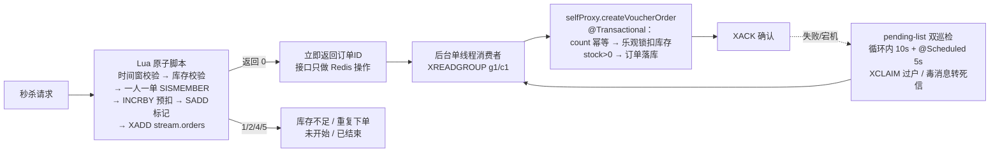

# 黑马点评 · 高并发本地生活服务平台

> 一个以 **Redis 高并发实战** 为核心的本地生活服务平台：商铺缓存、优惠券秒杀、探店笔记、关注 Feed 流、点赞排行、签到统计。
> 项目基于黑马程序员《黑马点评》课程骨架，**围绕秒杀链路与缓存体系做了独立的深度重构与加固**：Lua 原子预扣 + Stream 异步落库的最终一致架构、pending-list 双巡检兜底、毒消息死信收口、布隆过滤器前置拦截、逻辑过期 + 随机抖动防雪崩等，均为课程之外的自主实现。

---

## 一、技术栈

| 类别 | 技术 | 版本 | 用途 |
|------|------|------|------|
| 基础框架 | Spring Boot | 2.3.12.RELEASE | Web 容器、事务、定时任务 |
| ORM | MyBatis-Plus | 3.4.3 | 数据访问、乐观锁更新 |
| 缓存 / 消息 | Spring Data Redis + Lettuce | 2.6.2 / 6.1.6 | 缓存、Stream 消息队列、GEO / Bitmap / HyperLogLog |
| 分布式组件 | Redisson | 3.13.6 | 布隆过滤器（RBloomFilter） |
| 数据库 | MySQL | 5.7+ | 业务数据最终事实源 |
| 工具库 | Hutool / Lombok | 5.7.17 / - | Bean 拷贝、JSON、随机数、日志简化 |
| 压测 | JMeter | 5.x | 秒杀接口并发正确性验证 |

- 编译级别钉死 **JDK 8 字节码**（Spring Boot 2.3.12 内置 ASM 最高解析 major 57），可用 JDK 8~17 运行。
- 服务端口 **8081**，Redis 连接池 Lettuce pool（max-active=10）。

---

## 二、核心亮点

### 亮点 1：优惠券秒杀系统 —— Redis 预扣 + 异步落库的最终一致架构（重点）

**设计思想**：Redis 作为高并发前哨闸门负责快速拦截与预扣配额，数据库作为最终事实源负责落单兑现；不追求强分布式事务，靠 **消息重投向前滚 + 重试上限转死信 + 巡检兜底** 实现最终一致。核心原则：**宁可少卖，绝不超卖**。



**① 接入层：一个 Lua 脚本原子完成全部资格校验**（[seckill.lua](src/main/resources/seckill.lua)）

- 活动时间窗、库存、一人一单、扣减、标记、消息入队在 Redis 内原子执行，**无锁、无竞态、无 DB 压力**；
- 返回码约定：`0` 成功 / `1` 库存不足 / `2` 重复下单 / `4` 未开始 / `5` 已结束；
- 细节取舍：当前时间由 Java 以 ARGV 传入而非脚本内 `TIME`（TIME 属写命令，只读副本会执行失败）；库存先判 nil 再比较，key 未预热时按无库存处理而不是脚本崩溃；一人一单 Set 带 7 天 TTL 且每次下单续期，活动结束自然回收。

**② 消费层：单线程串行落库，天然规避并发竞态**（[VoucherOrderServiceImpl](src/main/java/com/hmdp/service/impl/VoucherOrderServiceImpl.java)）

- `@PostConstruct` 自动创建消费者组（`MKSTREAM` + `BUSYGROUP` 静默跳过），运行期 `NOGROUP` 就地重建自愈，Redis 未就绪不阻断启动；
- 全局仅一个消费者：同一用户的重复消息不会并发打架，库存扣减天然串行，**无需分布式锁**；
- 通过 `@Autowired @Lazy` 注入自身代理 `selfProxy` 调用事务方法，**修复了后台线程自调用导致 `@Transactional` 失效**的经典陷阱；
- 事务内三重保障：`count` 查询承担消息重复投递的幂等；`UPDATE ... SET stock=stock-1 WHERE stock>0` 乐观锁兜底防超卖；落库成功才 XACK，ACK 自身失败单独捕获、靠重投幂等补齐。

**③ 兜底层：pending-list 双巡检 + 死信收口（课程之外的自主加固）**

- 消费循环内每 10s 巡检一次 pending-list（单轮上限 100 条，毒消息不会卡死主循环）；
- 独立 `@Scheduled` 每 5s 巡检：`XPENDING` 只读查房 → idle≥30s 的消息用 `XCLAIM` 过户给 c1 由主循环处理（阈值显著大于 BLOCK + 事务耗时，防止抢走正在处理的消息）；
- 投递次数 >5 判定为毒消息转死信，操作顺序是硬约束：**先 XADD 死信 Stream 留痕 → 再 SREM 释放一人一单标记 → 最后 XACK**，颠倒顺序会在中途崩溃时既丢消息又把用户永久锁死；
- 死信前区分成因：订单已落库的"ACK 反复失败型"只补 ACK、严禁释放标记；
- 巡检线程**绝不执行业务**，保持全局单线程串行，避免 count 幂等查询在并发下竞态。

**④ 一致性取舍**

- DB 扣减确定性失败（如后台改小库存）：只 SREM 回滚该用户标记让其可重试，**不回补 Redis 库存**——库存是预扣配额，回补会突破真实库存；
- 业务失败不 ACK 不补偿，靠重投向前滚到成功；两边残差由死信与人工对账收口。

### 亮点 2：多层缓存防护体系 —— 穿透 / 击穿 / 雪崩全覆盖

以商铺查询为例，构建了一条完整的缓存防护链路（[CacheClient](src/main/java/com/hmdp/utils/CacheClient.java) + [ShopServiceImpl](src/main/java/com/hmdp/service/impl/ShopServiceImpl.java)）：

| 问题 | 方案 | 实现要点 |
|------|------|----------|
| 缓存穿透 | **布隆过滤器前置拦截** + 空值缓存双保险 | Redisson `RBloomFilter`（容量 2 倍预留、误判率 1%），非法 ID 不碰缓存和 DB；漏网的非法请求由空值缓存（短 TTL）兜底 |
| 缓存击穿 | **逻辑过期 + 异步重建**（主路径）；互斥锁方案作为通用工具保留 | 数据永不过期，读端比对 `expireTime`；过期后拿锁线程**双重检查**再提交异步重建，其余请求立即返回旧数据，永不阻塞 |
| 缓存雪崩 | **TTL 随机抖动** | 随机偏移统一加在公共写入口 `setWithLogicalExpire`（约 10% 抖动），预热 / 更新重建 / 过期重建三条写入路径一次性获得错峰能力 |
| 缓存一致性 | 先更 DB 再**重建**缓存 | 逻辑过期方案不能删 key（删了会未命中直接返回"不存在"），改为更新后立即重建 |
| 冷启动 | **启动预热** | `ApplicationRunner` 启动时初始化布隆过滤器 + 全量预热逻辑过期缓存；新增商铺即时补布隆 + 预热，避免误杀 |

异步重建由 Spring 托管的专用线程池 `cacheExecutor` 执行：核心 10 / 最大 20 / **有界队列 100** / `CallerRunsPolicy` 背压 / 优雅停机等待 30s，重建失败记日志保证可观测。

`CacheClient` 用 `Class<R>` 类型令牌 + `Function<ID,R>` 数据库回调解耦实体，任意业务可复用三种查询策略。

### 亮点 3：分布式锁的演进与取舍

完整走过 **SETNX 自研锁 → Redisson → Lua 原子脚本** 的演进路径：

1. `SimpleRedisLock`：SETNX + 过期时间 + 线程标识前缀判断（防误删），保留作学习对照；
2. 分析其不可重入、不可重试、超时误删等局限，引入 Redisson（可重入、看门狗续期、MultiLock）；
3. 秒杀场景最终**用 Lua 原子校验替代锁**——资格判断与扣减本身可以原子化时，锁就是多余的开销。Redisson 现仅服务于布隆过滤器。

> 面试可讲：不是"会用 Redisson"，而是理解**什么场景该用锁、什么场景该消灭锁**。

### 亮点 4：无状态登录认证 —— 双拦截器 + 滑动续期

- 短信验证码登录，验证码**用后即删**防 TTL 内重放；手机号不存在自动注册；
- 登录成功签发 UUID Token，脱敏用户信息以 Hash 存入 Redis（`login:token:{token}`）；
- **双拦截器架构**：`RefreshTokenInterceptor`（order 0，拦截一切请求）负责查 Token、刷新 TTL 实现**滑动续期**；`LoginInterceptor`（order 1）只判断 ThreadLocal 中是否有用户，职责分离；
- `UserHolder`（ThreadLocal）透传用户上下文，`afterCompletion` 统一清理防内存泄漏与线程复用串号。

### 亮点 5：Redis 数据结构的场景化应用

| 场景 | 数据结构 | 实现 |
|------|----------|------|
| 全局唯一订单 ID | String INCR | `RedisIdWorker`：31 位秒级时间戳 + 32 位序列号，按天分 key 防溢出，趋势递增利于 DB 索引 |
| 附近商铺 | GEO | `GEORADIUS` 按距离排序 + 内存截取分页，`ORDER BY FIELD` 保持距离序回查 DB |
| 点赞排行 | ZSet | score=点赞时间戳，天然去重 + Top5 时间序；取消点赞双向同步 DB 计数 |
| 关注 / 共同关注 | Set | `SINTER` 交集求共同关注 |
| 关注 Feed 流 | ZSet | **推模式**：发笔记时写入粉丝收件箱；**滚动分页**：`minScore + offset` 解决时间戳重复导致的翻页丢数据 / 重复读 |
| 用户签到 | Bitmap | `SETBIT` 按月存签到，`BITFIELD` 一次取回截止今天的位图，右移逐位统计连续签到 |
| UV 统计 | HyperLogLog | 百万级用户去重计数仅占 12KB（实验代码见测试类） |

---

## 三、关键设计决策与踩坑记录

| 问题 | 根因 | 解法 |
|------|------|------|
| 后台线程里 `@Transactional` 不生效 | Spring 事务基于代理，类内自调用绕过代理；后台线程也无法用 `AopContext.currentProxy()` | `@Autowired @Lazy` 注入自身代理 `selfProxy`，`@Lazy` 打破循环依赖 |
| 消费者组启动报 NOGROUP / 重复建组报错 | Stream 无消息时组不存在；`XGROUP CREATE` 重复执行抛 BUSYGROUP | `MKSTREAM` 建组 + 沿异常 cause 链匹配 BUSYGROUP 静默跳过 + 运行期 NOGROUP 自愈 |
| 毒消息把消费线程卡死 | 旧实现 pending 补偿是无界 `while(true)`，解析失败的消息无限重试 | 单轮条数上限 + 投递次数 >5 转死信止血 + 独立巡检与消费线程解耦 |
| XCLAIM 抢走正在处理的消息造成双处理 | 认领阈值小于一次消费耗时 | min-idle 30s 双保险（显著大于 BLOCK 2s + DB 事务耗时），idle 不足不抢 |
| 死信处理中途崩溃导致用户被永久锁死 | 先 ACK 后释放标记，崩溃窗口丢状态 | 硬约束顺序：留痕 → 释放标记 → ACK；已落库订单只补 ACK |
| 缓存重建任务堆积拖垮内存 | `Executors` 默认无界队列 | 有界队列 100 + `CallerRunsPolicy` 背压 + Spring 托管优雅停机 |
| 逻辑过期缓存更新后"店铺不存在" | 沿用删 key 策略导致未命中直接返回 null | 更新策略改为先更 DB 再重建缓存 |
| 编译产物在 Spring Boot 2.3.12 下 ASM 解析失败 | 全局 Maven profile 强制 JDK 17 字节码（major 61） | pom 显式钉死 source/target 1.8 + compiler 插件双保险 |

---

## 四、压测与正确性验证

配套完整的 JMeter 压测方案（详见 [秒杀模块压测方案.md](秒杀模块压测方案.md)），核心是**用数据核对而非只看错误率**：

- **场景**：500 并发用户（各自独立 Token）1 秒内打满，抢 100 库存的秒杀券，每人限抢一次；
- **三层断言**：HTTP 200 → JSON 结构合法 → Groovy 业务结果分类（成功 / 售罄 / 重复 / 时间无效），杜绝"200 即通过"的假阳性；
- **硬校验清单**：订单数恰好 = 初始库存、无重复用户订单、DB 与 Redis 库存均扣到 0 且不为负、`XPENDING` 残留为 0；
- **故障演练**：压测中途 kill 应用，重启后验证 pending-list 消息被补偿消费，订单不丢不重。

---

## 五、快速开始

### 环境要求

| 环境 | 版本 |
|------|------|
| JDK | 8+（推荐 8 或 17，字节码钉死 1.8） |
| MySQL | 5.7+ |
| Redis | 5.0+（GEO 使用 `GEORADIUS`，无需 6.2） |
| Maven | 3.x |

### 1. 导入数据库

```sql
CREATE DATABASE heimapoint DEFAULT CHARACTER SET utf8mb4;
-- 导入 src/main/resources/db/hmdp.sql
```

### 2. 修改配置

编辑 `src/main/resources/application.yaml` 中的 MySQL 与 Redis 连接信息（默认端口 8081）。

### 3. 启动

```bash
mvn clean package -DskipTests
java -jar target/hm-dianping-0.0.1-SNAPSHOT.jar
```

或 IDE 直接运行 `HmDianPingApplication`。启动时自动完成：商铺布隆过滤器初始化 + 逻辑过期缓存全量预热 + 秒杀消费者组创建。

### 4. 初始化 GEO 数据（可选）

运行测试类 `HmDianPingApplicationTests.loadShopData()` 将商铺坐标写入 Redis，即可体验附近商铺搜索。

### 5. 体验秒杀

1. `POST /user/code` 获取验证码 → `POST /user/login` 登录拿 Token；
2. `POST /voucher/seckill` 创建秒杀券（自动预热 Redis 库存与活动起止时间）；
3. 请求头携带 `authorization: {token}`，`POST /voucher-order/seckill/{voucherId}` 下单。

---

## 六、项目结构

```
src/main/java/com/hmdp/
├── config/          # Redisson、MVC 拦截器、缓存线程池、启动预热、全局异常
├── controller/      # REST API
├── dto/             # LoginFormDTO、UserDTO、Result、ScrollResult
├── entity/          # Shop、User、Voucher、VoucherOrder、Blog 等
├── mapper/          # MyBatis-Plus Mapper
├── service/impl/    # 业务实现（秒杀、缓存、Feed、签到等核心逻辑）
├── utils/           # CacheClient、RedisIdWorker、RedisConstants、
│                    # 双拦截器、UserHolder、SimpleRedisLock（演进对照）
└── HmDianPingApplication.java

src/main/resources/
├── application.yaml # 配置
├── seckill.lua      # 秒杀原子校验脚本
└── db/hmdp.sql      # 建库脚本
```

---

## 七、已知局限与演进方向

> 主动暴露边界并给出演进思路，是本项目工程化思考的一部分。

| 局限 | 现状与取舍 | 演进方向 |
|------|-----------|----------|
| 消费吞吐有上限 | 单线程串行，每条消息一次 DB 事务；换来的是无锁幂等与实现简单 | 按 voucherId/userId 哈希拆分多个 Stream 分区并行消费 |
| 幂等最后一道防线 | 依赖单线程串行 + count 查询，订单表暂无 `(user_id, voucher_id)` 唯一索引 | 补唯一索引，DB 层兜底 |
| Redis 与 DB 残差 | 死信留痕 + 人工排查 | 离线对账任务自动比对 `SCARD` 与订单数并抹平残差 |
| 博客评论模块 | 尚未实现 | 保存评论 + 按父评论分页查询 |
| 单体部署 | 秒杀消费与 Web 同进程 | 消费者独立部署，Stream 天然支持多消费者组水平扩展 |

---

## 八、配套文档

| 文档 | 内容 |
|------|------|
| [秒杀模块压测方案.md](秒杀模块压测方案.md) | JMeter 元件配置、三层断言、数据硬校验、故障演练 |
| [秒杀模块面试题库.md](秒杀模块面试题库.md) | 秒杀链路高频面试题与应答要点 |
| [面试应答资料.md](面试应答资料.md) | 项目整体面试串讲 |
| [项目完成度体检报告.md](项目完成度体检报告.md) | 逐模块完成度核查、Bug 修复记录、加固点清单 |